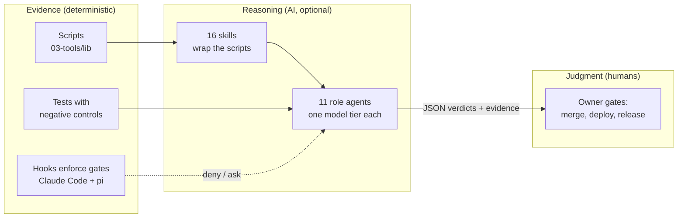
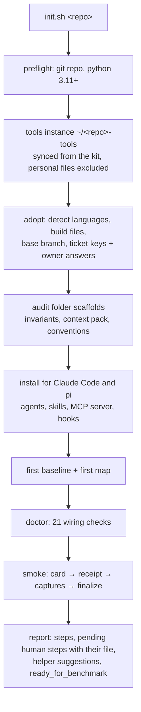
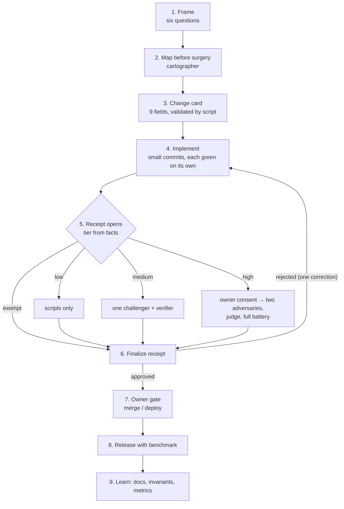

# Work Methodology

A lightweight, evidence-based methodology for shipping software changes that anyone on the team can explain,
review, and trust, plus the kit that makes it run with AI agents: roles, skills, deterministic scripts, hooks
that enforce the gates, and one command to plug it into a repository and unplug it again.

> **The idea in one sentence:** the model isn't the center, the method is. Scripts supply evidence, tests
> supply guarantees, agents supply reasoning, humans supply judgment.

## What this is, and what it is not

| It is | It is not |
|---|---|
| A way of working: frame, map, card, small commits, review sized by risk, verify, owner gate, learn | A framework you import into your code, or a runtime dependency |
| A kit for AI-assisted teams: 11 agent roles, 16 skills, a `metodo` MCP server, hooks for Claude Code and pi | A general-purpose chatbot setup; every agent has one role, one model tier and a JSON contract |
| Deterministic checks (Python 3 standard library + bash) with tests and negative controls | A linter collection that replaces your CI; it adds evidence on top of your own checks |
| Language guidance with the official rule quoted verbatim, then labeled house rules (Kotlin, Swift, Python, SQL, Haskell, Go, Gradle, Compose, SwiftUI) | A style war; official guides win, house rules are labeled as such |
| Usable by humans alone; AI agents are optional helpers | A way to hand decisions to AI: humans own every gate (merge, deploy, release, shared build files) |

## Why this methodology

Most teams don't fail from lack of talent. They fail from small, avoidable gaps:

- Changes nobody can explain six months later.
- Regressions that a quick review would have caught.
- Risk that slips through because "it looked fine."
- Context that lives only in one person's head and disappears when they're busy or gone.
- AI-generated output accepted on faith, without anyone checking it against reality.

The habits that close them: write down why before you write code, size the review to the risk, verify
claims against evidence, and keep a trail anyone can follow later.

## The idea in one picture

Think of a flight crew. The captain (the owner) decides; the checklists (scripts) are run the same way every
time; the co-pilot cross-checks (adversarial reviewers); the flight recorder (the review receipt and the
hook ledger) keeps what happened. Where the analogy breaks: a plane has one flight plan, while here each
change brings its own card, and the "checklist" can block a takeoff without asking anyone.



## Core ideas in 60 seconds

- **Evidence or silence.** Every claim cites something checkable (`file:line@sha`, a commit, pasted output) and
  carries a tag: Measured, Tested, Inferred, Assumed, Unknown. Like evidence in court: a witness statement
  (Inferred) is not a lab result (Tested). A tag drops when its evidence dies; it never rises without new evidence.
- **Protect properties, not code.** Each project ranks what matters (e.g. data integrity, correctness,
  security) and uses that ranking to break ties.
- **Simplicity first.** The simplest solution that meets the invariants wins. No speculative abstractions.
- **A change card before a change.** Nine short fields (why, for what, what it risks, when, how, how far, how
  we'll know, invariant, ticket), like a prescription: the reason, the dose, the side effects, and how you'll
  know it worked. No card, no PR; a script validates it.
- **Review scaled by risk.** Like triage in an emergency room: a scratch gets a plaster, a chest pain gets the
  full team. Docs get nothing; critical paths get two independent adversaries, a judge and the owner.
- **An owner gate for shared state.** Deploys, merges, releases and shared build files always pass through a
  named, accountable person. Hooks make that a rule, not a habit.
- **Everything that can be a script is a script.** Same input, same output, no timestamps; the model
  interprets, it never re-derives numbers.

## Start here

Pick the path that fits you:

| You want to… | Read / run | Time |
|---|---|---|
| Understand the method (no AI needed) | `docs/01-principles.md`, then `docs/02-workflow.md` | 30 min |
| Plug the kit into a repository | `03-tools/bin/init.sh <repo> --dry-run`, then without `--dry-run` (below) | 10 min + owner answers |
| Brief an AI agent on this repo | `AGENTS.md` (Claude Code reads it through `CLAUDE.md`), then `CONTEXT-PACK.md` | 5 min |
| Change the kit itself | `AGENTS.md` "Rules when changing this kit", then `00-principles/methodology.md` | 20 min |

<!-- kit-status:start -->
| Kit status (`03-tools/bin/kit-status.sh --write`, never by hand) | Value | Tag |
|---|---|---|
| measured_at | `88df8a7`, dirty: yes | [Measured] |
| code_fingerprint | `sha256:9f04c086e1e922c6` over 197 files (roles, skills, tools, tests) | [Measured] |
| structure | 11 agents, 16 skills (16 installed), 30 MCP tools, 7 Claude hooks, 793 test cases | [Measured] |
| kit suite | OK: ran 793, failures 0, errors 0, skipped 5, expected failures 2 | [Tested] |
| docs caps | 0 offenders, 0 missing (`config/docs-caps.json` over this checkout) | [Measured] |
| init on a Gradle/Kotlin fixture | doctor PASS, kit_installed true, smoke PASS, loop_ran true, ready_for_benchmark true; 25 pending human steps | [Tested] |
| init suggestions | 0 missing, 1 unknown of 6 suggested helpers (temp HOME) | [Measured, this machine] |
| init idempotency | second run's report byte-identical: yes | [Tested] |
<!-- kit-status:end -->

### Plug it in, check it, unplug it

Like moving in with a removal company that also connects the utilities: it carries everything in, tests
that the lights and the water work, and hands you a list of what only you can decide (which room is the
nursery). Moving out leaves the place as you found it. Where it breaks: the company never touches anything
you brought yourself, even if it looks like theirs.

```bash
03-tools/bin/init.sh <repo> --dry-run      # the plan; writes nothing anywhere
03-tools/bin/init.sh <repo>                # do it (or the init-kit skill, which interviews the owner first)
03-tools/bin/doctor.sh <repo> --tools <instance>   # is everything wired? each FAIL names its fix
03-tools/bin/smoke-loop.sh <repo>          # does the review loop run end to end? (on a throwaway clone)
03-tools/bin/init.sh <repo> --uninstall    # unplug: removes only what the kit installed, untouched
```



Nothing is installed globally and nothing is skipped silently: whatever init cannot decide (the property
hierarchy, invariants, people and gates) comes back as a pending human step naming its file. Helpers such as
Engram (memory), Context7 (docs) or gentle-ai are detected and suggested with the exact command, never
installed. `05-adopt/checklist.md` marks every adoption item as done by init or left to a human.

## How a change flows



| Step | Who | What leaves the step |
|---|---|---|
| 1. Frame | Author | Six questions answered or marked Unknown (`docs/01-principles.md`) |
| 2. Map | Cartographer (script + agent) | What exists, what to reuse, what will collide |
| 3. Card | Proposer | A 9-field card that passes `change_card_validator.py` and returns its review lane |
| 4. Implement | Proposer | Small commits; new comments only where the code can't say why (comment gate) |
| 5. Review | Challenger, blind-spot adversary, judge | JSON findings: OK / NUANCE / BROKEN, CLOSED / OPEN WITH OWNER / CONTAINED |
| 6. Verify | Verifier, in a clean context | PASS / FAIL / INCONCLUSIVE against the card's "how we'll know" |
| 7. Owner gate | Owner | Merge or deploy decision; hooks block pushes and merges without it |
| 8. Release | Owner + author | Benchmark against the last shipped tag, with "what was NOT measured" |
| 9. Learn | Author | Updated docs, invariants and the README status block |

### The review receipt (RDD)

A receipt is like the store receipt stapled to a shopping bag: it proves exactly which items were checked
out, at what price, and nobody can add an item afterwards without a new receipt. It is tied to the commit's
**tree** (`HEAD^{tree}`), so amending only the message keeps it and changing any file voids it.

| Tier | Chosen when (first match, by `rdd_risk.py`) | What runs |
|---|---|---|
| exempt | no files, or docs only | nothing; born approved |
| high | shared build files, critical paths, or a card in the large-model lane | owner consent, two adversaries, a judge, the full test battery |
| low | tests or docs only, or "What it risks: none" with a small diff | scripts only: role contract, comment gate, docs caps |
| medium | everything else | one challenger with one lens + a verifier |

`finalize` reads only the captures: a script that rejects (role contract FAIL, a doc over its cap) rejects the
receipt; a BROKEN finding not refuted by the judge rejects it; an open blind spot without a ruling escalates
it. A rejection allows one correction; the second goes to the owner. Approval never pushes or opens a PR.

## The roles

| Role | Tier (model today) | What it does | In one image |
|---|---|---|---|
| cartographer | medium (Sonnet 5.5) | Maps the repo before surgery: modules, hotspots, collisions | The surveyor before the builders |
| proposer | medium (Sonnet 5.5) | Implements exactly the card's "how"; leaves `NEEDS-COMMENT` instead of comments | The surgeon who sticks to the plan |
| challenger | large (Opus 5.5) | Attacks what the change claims, with a lens and a simpler alternative | The cross-examining lawyer |
| blind-spot adversary | large (Opus 5.5) | Looks for what nobody is watching | The inspector who checks the attic |
| judge | medium (Sonnet 5.5), large on a P0 | Rules on findings: CONFIRMED / REFUTED / NEEDS_BENCH / UNRESOLVED | The referee with the rulebook |
| verifier | medium (Sonnet 5.5) | Checks the change in a clean context against the card | The second opinion |
| boundary reviewer | medium (Sonnet 5.5) | Dependency boundaries that must not be crossed | The border control |
| style reviewer, comment gate, human reviewer | small (Haiku 5.5) | Interpret a measured result against a fixed rulebook | The proofreader |
| mechanic | small (Haiku 5.5) | Applies trivial approved fixes, nothing else | The technician who tightens the bolts |

Models are pinned by full id (`claude-haiku-5-5`, `claude-sonnet-5-5`, `claude-opus-5-5`), so a subagent never inherits
the session's model; Opus 5.5 orchestrates, and Fable 5.1 runs only as an owner-approved escalation. Each role has a
`.contract.json`: what it may write, what is forbidden (shared build files, `.claude/**`), no subagent spawning, and a
tool-call budget a hook enforces. Agents answer JSON against a schema, never prose dumps, and never talk to the owner:
the orchestrator does.

## The skills and the tools

| Skill (`02-skills/`) | Use it to |
|---|---|
| `init-kit` | Interview the owner and run `init.sh`; relay the report without inventing numbers |
| `change-card` | Validate a card and get its review lane |
| `cartography`, `clean-pass`, `repo-metrics` | Map the repo, sweep it for cleanup candidates, compare shape with the baseline |
| `receipt-review`, `adversarial-round` | Open the receipt and run the review its tier calls for |
| `necessary-comment` | Gate every new comment: the code must explain itself |
| `verify-per-commit` | Find which commit broke the battery |
| `pr-message`, `benchmark-release`, `real-environment-minutes` | Deliver: PR body, release benchmark, field-test minutes |
| `review-comment`, `post-review-comment` | Write a review comment with a fixed shape and post it |
| `human-reply`, `human-review` | Check replies to people against the communication rules (COM-01..19) |

What the harness enforces so nobody has to remember it (`03-tools/hooks/`, same Python for Claude Code and pi):
subagents can't edit shared build files (every Gradle build file included) or `.claude/**`; `git push --force`
without lease is denied; subagents can't push, open PRs, merge or tag; each subagent has a tool-call budget;
each role's output is validated against its schema on close; pushes without an approved receipt are logged
(or asked, in block mode). Everything lands in a ledger.

## How to work, day to day

1. **Frame and card first.** Answer the six questions; write the card; `change-card` returns its lane.
2. **One idea per commit, green on its own.** The battery passes on every commit, not only at the end.
3. **Open the receipt on the committed candidate** (`receipt-review`). Run only what the tier asks for.
4. **Say what you did not test.** "What was NOT tested" is a mandatory PR section; skipped checks go there.
5. **Stop at the gates.** Push, PR, merge, release and shared build files are the owner's decisions.
6. **Talk like a person.** Answer first, two layers (human, then technical detail), evidence tags below.

Changing the kit itself follows the same rules plus three of its own: behavior changes are test-first
(`cd 03-tools && METODO_MEMORY=off python3 -m unittest discover tests`), every document stays under its line
cap (`python3 03-tools/lib/docs_lint.py 03-tools/config/docs-caps.json`), and an important change lands with
the status block above re-measured in the same commit (`03-tools/bin/kit-status.sh --write`, checked by a
test). Artifacts are in English; nothing names a client, a provider or a personal path.

## Is it worth it? (measured, not assumed)

`08-benchmark/` compares the kit against a vanilla harness: a metric catalogue, a pre-registered protocol, an
A/B runner with a blind judge, and the reports. Phase 1 (retrospective) supports delegation, gates and commit
hygiene; it does not yet support that lints change replies, that memory gives continuity, or that the router
helps, and it says so in its "bullshit meter" (`08-benchmark/reports/phase1-findings.md`). A kit run counts
only if `init.sh` reports `ready_for_benchmark` for that repo: a half-installed kit is not a kit arm.

## Repository map

| Path | Content |
|---|---|
| `docs/` | The friendly entry layer: principles, workflow, change card, review, work management, git/release, adoption |
| `AGENTS.md`, `CLAUDE.md`, `CONTEXT-PACK.md` | How an agent enters, and the whole method in ≤ 120 lines |
| `00-principles/` | The operating law: evidence, why-layer, change card, review receipt, model and multi-provider routing, runtime adapters, agent protocol |
| `01-roles/agents/` | The 11 roles, each with its `.contract.json` |
| `02-skills/` | The 16 skills (`SKILL.md`) |
| `03-tools/` | `bin/` (init, doctor, smoke, install, adopt, metrics, kit-status…), `lib/` checkers, `hooks/`, `mcp/` server, `config/`, `schemas/`, `tests/` |
| `04-templates/` | Change card, PR, findings, release benchmark, project profile, agent brief, round minutes |
| `05-adopt/` | The adoption checklist, each item marked init or human |
| `06-languages/` | Official rule verbatim + labeled house rules + detectors, per language and build tool |
| `07-communication/` | How an agent talks to a person: identity block, COM rules with a linter, templates, provider adapters, its own benchmark |
| `08-benchmark/` | Kit vs vanilla: metrics, protocols, runners, reports |
| `odd/` | Task documents (specs, tasks, log) for the kit's own changes |

## Glossary

| Term | Meaning |
|---|---|
| Protected property | A system quality (e.g. data integrity) ranked so trade-offs have a consistent tie-breaker |
| Invariant | Something that must always stay true, with the mechanism that guards it |
| Change card | The 9-field defense of a change, validated by script |
| Review receipt | The record tying a review to an exact tree: tier, budget, captures, verdict |
| Risk tier | Review depth: exempt, low, medium, high |
| Challenger / blind-spot adversary | The reviewer who attacks the claims / the one who hunts what nobody watches |
| Owner gate | A decision (merge, deploy, release, shared build files) only a named person can take |
| Tools instance | A per-project copy of `03-tools` holding that project's config, outside its repo |
| Doctor / smoke | Wiring check of an installed kit / the review loop run end to end on a throwaway clone |
| Epistemic tag | Measured, Tested, Inferred, Assumed or Unknown, on every claim |

## FAQ

**Is this too heavy for small changes?** No. The tier scales it down: a docs change is exempt, a test-only
change runs scripts only. See `docs/04-review.md`.

**Do we need AI agents?** No. The method works with humans alone; agents are optional helpers
(`docs/07-adoption.md`), and humans own every gate.

**Which AI tools does the kit support?** Claude Code and pi today, from one source (`00-principles/runtime-adapters.md`).
Other providers' models are admitted per role only after a measured trial (`00-principles/multi-provider-routing.md`).

**Will it touch my global config or install things?** No. Everything goes into the target repo, its tools
instance and its audit folder; global configs are read only with `--read-global-config`, and never written.

**How do I remove it?** `03-tools/bin/init.sh <repo> --uninstall` (add `--purge` to also delete the instance
and audit folder, only when they hold nothing but what init left).

**Can we start with just part of this?** Yes: see "Minimum viable adoption" in `docs/07-adoption.md`.

## License / usage

This methodology is provided for internal use. Adapt it freely to fit your team and project.
